# Credit Card Fraud Detection — End-to-End ML Pipeline


> **End-to-end fraud detection pipeline on 284,807 real credit card transactions — from SQL data sourcing through XGBoost modelling, SHAP explainability, business cost analysis, and an interactive Tableau monitoring dashboard.**

---

## Project Summary

| Metric                              | Value                                                           |
| ----------------------------------- | --------------------------------------------------------------- |
| Dataset                             | 284,807 transactions, 492 fraud cases                           |
| Fraud rate                          | 0.1727% (577:1 imbalance)                                       |
| Model                               | XGBoost + scale_pos_weight + GridSearchCV                       |
| AUC-ROC                             | **0.977**                                                       |
| AUC-PR                              | **0.880**                                                       |
| Precision (threshold 0.09)          | **0.813**                                                       |
| Recall (threshold 0.09)             | **0.888**                                                       |
| F1 Score (threshold 0.09)           | **0.849**                                                       |
| Fraud caught (TP)                   | 87 / 98 (88.8%)                                                 |
| Fraud missed (FN)                   | 11                                                              |
| False alarms (FP)                   | 20                                                              |
| Total business cost                 | **$1,950** (FN × $150 + FP × $15, assumed costs)                |
| Fraud cost avoided                  | **$13,050** (87 caught × assumed $150)                          |
| Net saving vs no model              | **$12,750** (under the assumed cost matrix)                     |
| Actual fraud value caught / missed  | $8,547.84 caught / $1,825.93 missed, of $10,373.77 total (82.4% by value) |

AUC-ROC and AUC-PR do not depend on the threshold. Precision, Recall and F1 do: the 0.09 threshold was chosen to minimise cost (Phase 7). Evaluated on a hold-out set of 56,962 transactions containing 98 fraud cases (stratified 80/20 split).

---

## Pipeline Overview

```
Raw Data (Kaggle CSV)
        ↓
Phase 1 — MySQL SQL Analysis
        ↓
Phase 2 — Python EDA (8 charts)
        ↓
Phase 3 — Feature Engineering (8 new features)
        ↓
Phase 4 — Class Imbalance (scale_pos_weight vs SMOTE + threshold tuning)
        ↓
Phase 5 — XGBoost Modelling (GridSearchCV)
        ↓
Phase 6 — SHAP Explainability (6 charts)
        ↓
Phase 7 — Business ROI & Cost Analysis
        ↓
Phase 8 — Tableau Interactive Dashboard
```

---

## Dataset

**Source:** [Kaggle — Credit Card Fraud Detection](https://www.kaggle.com/datasets/mlg-ulb/creditcardfraud) (ULB Machine Learning Group)

- 284,807 transactions by European cardholders over 2 days
- Features V1–V28: PCA-anonymised for privacy
- `Time`: seconds since the first transaction
- `Amount`: transaction amount
- `Class`: 0 = legitimate, 1 = fraud
- **No missing values**

---

## Phase 1 — SQL Analysis (MySQL)

Loaded raw CSV into MySQL and explored fraud patterns using pure SQL before any Python modelling.

**Loading the data:**

```sql
CREATE DATABASE IF NOT EXISTS fraud_detection;
USE fraud_detection;

CREATE TABLE IF NOT EXISTS transactions (
    Time DOUBLE,
    V1 DOUBLE, V2 DOUBLE, -- ... V3 to V27 ... --, V28 DOUBLE,
    Amount DOUBLE,
    Class TINYINT
);

-- The file must sit in the folder returned by: SHOW VARIABLES LIKE 'secure_file_priv';
LOAD DATA INFILE 'C:/ProgramData/MySQL/MySQL Server 8.0/Uploads/creditcard.csv'
INTO TABLE transactions
FIELDS TERMINATED BY ','
ENCLOSED BY '"'
LINES TERMINATED BY '\n'
IGNORE 1 ROWS;
```

**5 key queries written:**

```sql
-- QUERY 1 — Class Distribution & Key Amount Stats
-- Q: "How imbalanced is the dataset? Quantify it."

SELECT
    CASE Class WHEN 0 THEN 'Legitimate' ELSE 'Fraud' END   AS class_label,
    COUNT(*)                                                AS txn_count,
    ROUND(COUNT(*) * 100.0 / SUM(COUNT(*)) OVER(), 4)      AS pct_of_total,
    ROUND(AVG(Amount), 2)                                   AS avg_amount,
    ROUND(MIN(Amount), 2)                                   AS min_amount,
    ROUND(MAX(Amount), 2)                                   AS max_amount,
    ROUND(STD(Amount),  2)                                  AS std_amount
FROM transactions
GROUP BY Class
ORDER BY Class;

-- Imbalance ratio
SELECT
    SUM(CASE WHEN Class = 0 THEN 1 ELSE 0 END)              AS legit_count,
    SUM(CASE WHEN Class = 1 THEN 1 ELSE 0 END)              AS fraud_count,
    ROUND(
        SUM(CASE WHEN Class = 0 THEN 1 ELSE 0 END) /
        SUM(CASE WHEN Class = 1 THEN 1 ELSE 0 END)
    , 0)                                                    AS imbalance_ratio
FROM transactions;

-- QUERY 2 — Fraud Rate by Hour of Day
-- Q: "Which hours have the highest fraud rate? Write a query to find out."

SELECT
    FLOOR(Time / 3600) MOD 24                               AS hour_of_day,
    COUNT(*)                                                AS total_txns,
    SUM(Class)                                              AS fraud_count,
    COUNT(*) - SUM(Class)                                   AS legit_count,
    ROUND(SUM(Class) * 100.0 / COUNT(*), 4)                 AS fraud_rate_pct,
    ROUND(AVG(Amount), 2)                                   AS avg_amount,
    ROUND(AVG(CASE WHEN Class = 1 THEN Amount END), 2)      AS avg_fraud_amount,
    ROUND(AVG(CASE WHEN Class = 0 THEN Amount END), 2)      AS avg_legit_amount
FROM transactions
GROUP BY hour_of_day
ORDER BY fraud_rate_pct DESC;

-- Top 5 highest fraud-rate hours
SELECT
    FLOOR(Time / 3600) MOD 24                               AS hour_of_day,
    COUNT(*)                                                AS total_txns,
    SUM(Class)                                              AS fraud_count,
    ROUND(SUM(Class) * 100.0 / COUNT(*), 4)                 AS fraud_rate_pct
FROM transactions
GROUP BY hour_of_day
ORDER BY fraud_rate_pct DESC
LIMIT 5;

-- QUERY 3 — Amount Bucket Analysis (CASE WHEN bucketing)
-- Q: "Bin transactions by amount and show fraud concentration per bucket."

SELECT
    CASE
        WHEN Amount < 10                    THEN '1. Under $10'
        WHEN Amount BETWEEN 10   AND 49.99  THEN '2. $10 - $49'
        WHEN Amount BETWEEN 50   AND 99.99  THEN '3. $50 - $99'
        WHEN Amount BETWEEN 100  AND 199.99 THEN '4. $100 - $199'
        WHEN Amount BETWEEN 200  AND 499.99 THEN '5. $200 - $499'
        ELSE                                     '6. $500 +'
    END                                                     AS amount_bucket,
    COUNT(*)                                                AS total_txns,
    SUM(Class)                                              AS fraud_txns,
    COUNT(*) - SUM(Class)                                   AS legit_txns,
    ROUND(SUM(Class) * 100.0 / COUNT(*), 3)                 AS fraud_rate_pct,
    ROUND(AVG(Amount), 2)                                   AS avg_amount,
    ROUND(SUM(CASE WHEN Class = 1 THEN Amount ELSE 0 END), 2) AS total_fraud_amount
FROM transactions
GROUP BY amount_bucket
ORDER BY amount_bucket;

-- QUERY 4 — Transaction Velocity (Window Functions)
-- Q: "Approximate how many transactions happen in short time windows
--     and whether velocity correlates with fraud."

-- Step 1: tag each transaction with its minute bucket count
WITH velocity_tagged AS (
    SELECT
        Class,
        Amount,
        FLOOR(Time / 3600) MOD 24                           AS hour_of_day,
        FLOOR(Time / 60)                                    AS minute_bucket,
        COUNT(*) OVER (
            PARTITION BY FLOOR(Time / 60)
        )                                                   AS txns_in_same_minute
    FROM transactions
)
-- Step 2: bucket by velocity and compute fraud rate
SELECT
    CASE
        WHEN txns_in_same_minute = 1    THEN '1 txn  (low velocity)'
        WHEN txns_in_same_minute <= 3   THEN '2-3 txns'
        WHEN txns_in_same_minute <= 6   THEN '4-6 txns'
        WHEN txns_in_same_minute <= 10  THEN '7-10 txns'
        ELSE                                 '10+ txns (high velocity)'
    END                                                     AS velocity_bucket,
    COUNT(*)                                                AS total_txns,
    SUM(Class)                                              AS fraud_txns,
    ROUND(SUM(Class) * 100.0 / COUNT(*), 4)                 AS fraud_rate_pct,
    ROUND(AVG(Amount), 2)                                   AS avg_amount
FROM velocity_tagged
GROUP BY velocity_bucket
ORDER BY velocity_bucket;

-- Time gap between consecutive transactions
WITH ordered AS (
    SELECT
        Class,
        Amount,
        Time,
        LAG(Time) OVER (ORDER BY Time)                      AS prev_time
    FROM transactions
)
SELECT
    Class,
    CASE
        WHEN (Time - prev_time) < 1     THEN 'Under 1 sec'
        WHEN (Time - prev_time) < 10    THEN '1-10 secs'
        WHEN (Time - prev_time) < 60    THEN '10-60 secs'
        WHEN (Time - prev_time) < 300   THEN '1-5 mins'
        ELSE                                 '5 mins +'
    END                                                     AS time_gap_bucket,
    COUNT(*)                                                AS txn_count,
    ROUND(AVG(Amount), 2)                                   AS avg_amount
FROM ordered
WHERE prev_time IS NOT NULL
GROUP BY Class, time_gap_bucket
ORDER BY Class, time_gap_bucket;

-- QUERY 5 — Executive Summary (Single Query KPI View)
-- Q: "Give me one query that tells a risk officer everything they need to know."

SELECT
    -- Volume
    COUNT(*)                                                AS total_transactions,
    SUM(Class)                                              AS total_fraud,
    COUNT(*) - SUM(Class)                                   AS total_legitimate,

    -- Rates
    ROUND(SUM(Class) * 100.0 / COUNT(*), 4)                 AS fraud_rate_pct,

    -- Imbalance
    ROUND(
        (COUNT(*) - SUM(Class)) / SUM(Class)
    , 0)                                                    AS imbalance_ratio,

    -- Fraud amounts
    ROUND(SUM(CASE WHEN Class=1 THEN Amount ELSE 0 END), 2) AS total_fraud_value,
    ROUND(AVG(CASE WHEN Class=1 THEN Amount END),        2) AS avg_fraud_amount,
    ROUND(AVG(CASE WHEN Class=0 THEN Amount END),        2) AS avg_legit_amount,
    ROUND(MAX(CASE WHEN Class=1 THEN Amount END),        2) AS max_fraud_amount,

    -- Share of fraud under $100
    ROUND(
        SUM(CASE WHEN Class=1 AND Amount < 100 THEN 1 ELSE 0 END)
        * 100.0 / SUM(Class)
    , 1)                                                    AS fraud_pct_under_100,

    -- Time span
    ROUND(MIN(Time) / 3600, 1)                              AS data_start_hr,
    ROUND(MAX(Time) / 3600, 1)                              AS data_end_hr,
    ROUND((MAX(Time) - MIN(Time)) / 3600, 1)                AS data_span_hrs

FROM transactions;

-- VIEWS — Reusable named queries (feed Phase 2 & Tableau)

-- View 1: fraud_hourly_summary
DROP VIEW IF EXISTS fraud_hourly_summary;
CREATE VIEW fraud_hourly_summary AS
SELECT
    FLOOR(Time / 3600) MOD 24                               AS hour_of_day,
    COUNT(*)                                                AS total_txns,
    SUM(Class)                                              AS fraud_count,
    COUNT(*) - SUM(Class)                                   AS legit_count,
    ROUND(SUM(Class) * 100.0 / COUNT(*), 4)                 AS fraud_rate_pct,
    ROUND(AVG(Amount), 2)                                   AS avg_amount,
    ROUND(AVG(CASE WHEN Class=1 THEN Amount END), 2)        AS avg_fraud_amount
FROM transactions
GROUP BY hour_of_day;

-- View 2: fraud_amount_buckets
DROP VIEW IF EXISTS fraud_amount_buckets;
CREATE VIEW fraud_amount_buckets AS
SELECT
    CASE
        WHEN Amount < 10                    THEN '1. Under $10'
        WHEN Amount BETWEEN 10   AND 49.99  THEN '2. $10 - $49'
        WHEN Amount BETWEEN 50   AND 99.99  THEN '3. $50 - $99'
        WHEN Amount BETWEEN 100  AND 199.99 THEN '4. $100 - $199'
        WHEN Amount BETWEEN 200  AND 499.99 THEN '5. $200 - $499'
        ELSE                                     '6. $500 +'
    END                                                     AS amount_bucket,
    COUNT(*)                                                AS total_txns,
    SUM(Class)                                              AS fraud_txns,
    ROUND(SUM(Class) * 100.0 / COUNT(*), 3)                 AS fraud_rate_pct
FROM transactions
GROUP BY amount_bucket;

-- View 3: clean_transactions (Phase 2 Python feed)
DROP VIEW IF EXISTS clean_transactions;
CREATE VIEW clean_transactions AS
SELECT
    Time,
    FLOOR(Time / 3600) MOD 24                               AS hour_of_day,
    CASE
        WHEN FLOOR(Time / 3600) MOD 24 BETWEEN 0  AND 5  THEN 'Night'
        WHEN FLOOR(Time / 3600) MOD 24 BETWEEN 6  AND 11 THEN 'Morning'
        WHEN FLOOR(Time / 3600) MOD 24 BETWEEN 12 AND 17 THEN 'Afternoon'
        ELSE                                                    'Evening'
    END                                                     AS time_of_day,
    Amount,
    LOG(Amount + 1)                                         AS log_amount,
    V1,  V2,  V3,  V4,  V5,  V6,  V7,
    V8,  V9,  V10, V11, V12, V13, V14,
    V15, V16, V17, V18, V19, V20, V21,
    V22, V23, V24, V25, V26, V27, V28,
    Class
FROM transactions;

-- Verify all views
SELECT
    table_name   AS view_name,
    table_type
FROM information_schema.tables
WHERE table_schema = 'fraud_detection'
ORDER BY table_type, table_name;

-- EXPORT 1: full clean dataset -> for Python Phase 2
-- Workbench caps result grids at 1,000 rows, so export server-side with INTO OUTFILE.
-- INTO OUTFILE writes NO header row (the notebook reads it with header=None).
SELECT * FROM clean_transactions
INTO OUTFILE 'C:/ProgramData/MySQL/MySQL Server 8.0/Uploads/clean_transactions_full.csv'
FIELDS TERMINATED BY ','
OPTIONALLY ENCLOSED BY '"'
LINES TERMINATED BY '\n';

-- EXPORT 2 / 3: small summaries (Tableau)
SELECT * FROM fraud_hourly_summary ORDER BY hour_of_day;
SELECT * FROM fraud_amount_buckets ORDER BY amount_bucket;
```

**Results returned by the queries:**

Fraud rate by hour (top rows):

| hour | total txns | fraud | fraud rate |
| ---- | ---------- | ----- | ---------- |
| **2** | 3,328     | 57    | **1.713%** |
| 4    | 2,209      | 23    | 1.041%     |
| 3    | 3,492      | 17    | 0.487%     |
| 5    | 2,990      | 11    | 0.368%     |
| 7    | 7,243      | 23    | 0.318%     |

Fraud by amount bucket:

| bucket     | transactions | fraud   | fraud rate |
| ---------- | ------------ | ------- | ---------- |
| Under $10  | 97,314       | **249** | 0.256%     |
| $10–$49    | 92,390       | 56      | 0.061%     |
| $50–$99    | 37,718       | 57      | 0.151%     |
| $100–$199  | 28,070       | 45      | 0.160%     |
| $200–$499  | 19,823       | 50      | 0.252%     |
| $500+      | 9,492        | 35      | **0.369%** |

**SQL findings:**

- 577:1 class imbalance — fraud is 0.17% of all transactions
- Fraud rate peaks at **2am (1.713%, about 10x the dataset average)**, then 4am (1.041%)
- 73.6% of fraud transactions are under $100, but the pattern is two-sided: the **most fraud cases are under $10 (249)** and the **highest fraud rate is $500+ (0.369%)**; the $10–$49 band is the safest (0.061%)
- Window functions (`COUNT(*) OVER PARTITION BY`) used for velocity approximation — the dataset has no card ID, so this counts all transactions in a window
- `INTO OUTFILE` used for the 284,807-row export because Workbench limits result grids to 1,000 rows

**3 reusable views created:**

- `clean_transactions` — enriched data feed for Python
- `fraud_hourly_summary` — hourly fraud rates
- `fraud_amount_buckets` — fraud by amount band

---

## Phase 2 — Exploratory Data Analysis

**8 charts produced:**

| Chart                | Key Finding                                                              |
| -------------------- | ------------------------------------------------------------------------ |
| Class imbalance      | 577:1 ratio — accuracy is meaningless                                    |
| Fraud by hour        | Peak at 2am (1.713%) and 4am (1.041%) — low-volume hours                 |
| Fraud by time of day | Night (0–5am) fraud rate 0.518% vs 0.141% in the day (3.7x)              |
| Amount distributions | Fraud median $9.25 vs $22.00 legitimate; 73.6% of fraud is under $100    |
| Log-amount transform | `log(Amount + 1)` used to reduce right skew                              |
| Feature correlations | V17, V14, V12, V10, V16 most correlated with fraud (\|r\| 0.20–0.33)    |
| KDE separation       | Fraud vs legitimate distributions of the top correlated features         |
| Correlation heatmap  | PCA features have near-zero correlation with each other                  |

**Key insight:** V17 (-0.3265) and V14 (-0.3025) have the strongest correlation with fraud. In SHAP (Phase 6), V14 ranks #1 but V17 does not appear in the top 20.

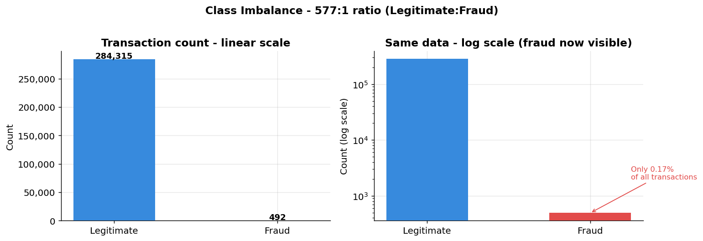
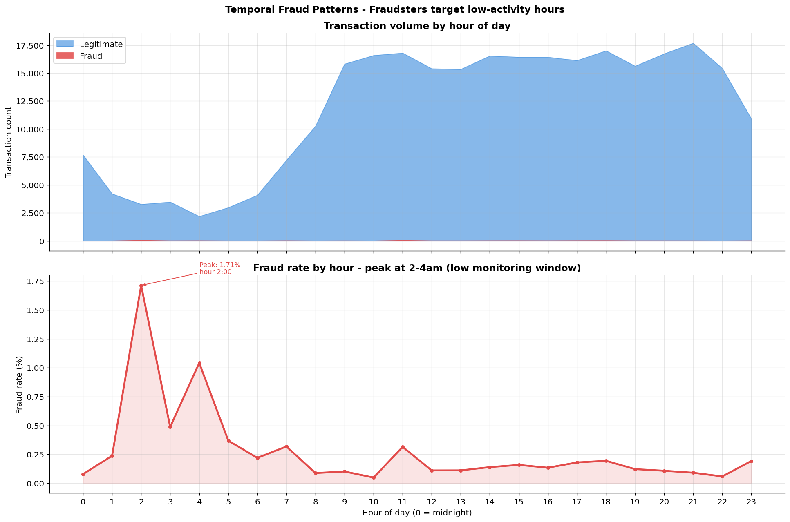
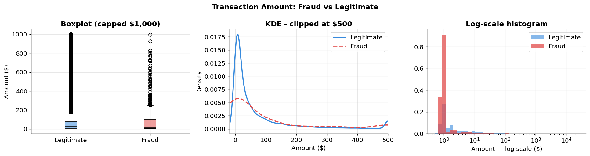
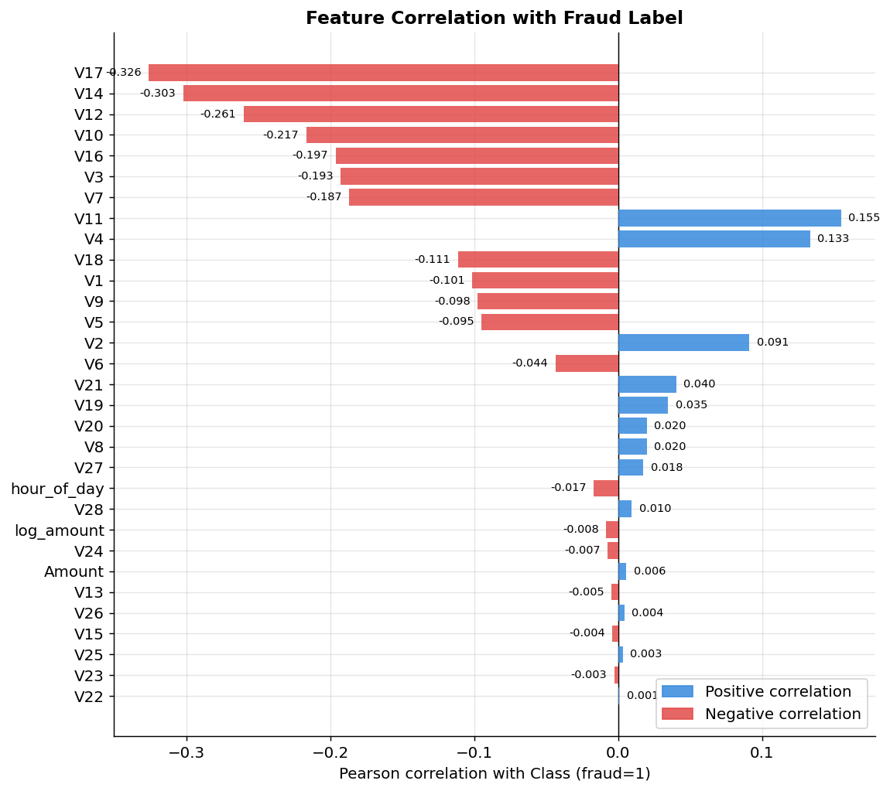
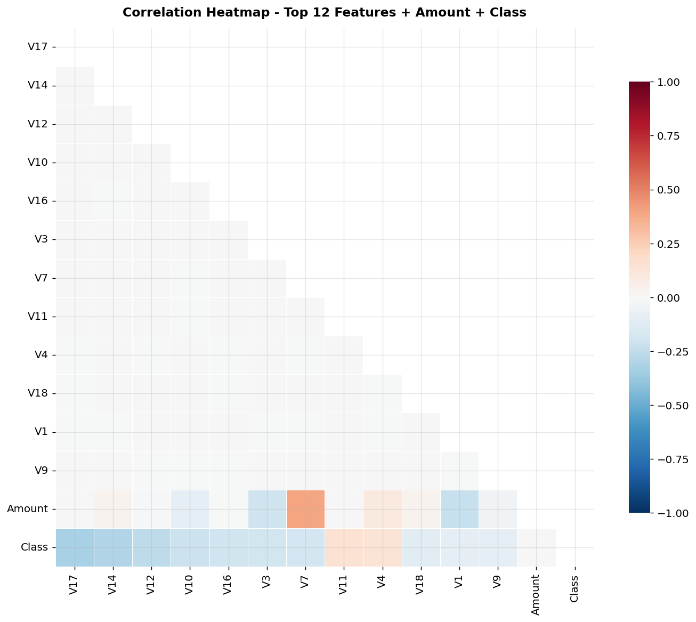

---

## Phase 3 — Feature Engineering

Built 8 new features on top of 28 PCA features (the model uses 38 features in total, including `log_amount` and `hour_of_day` from the SQL view):

| Feature            | Type          | Rationale                                              | Correlation with fraud |
| ------------------ | ------------- | ------------------------------------------------------ | ---------------------- |
| `is_night`         | Binary        | Hours 0–5am — peak fraud window                        | +0.0252                |
| `amt_zscore`       | Continuous    | Flags extreme amounts                                  | +0.0056                |
| `amt_bucket`       | Ordinal (0–5) | Amount band (fraud rate is highest under $10 and $500+) | +0.0016               |
| `txn_velocity_1h`  | Continuous    | Transactions in the same 1-hour window                 | -0.0246                |
| `txn_velocity_10m` | Continuous    | Transactions in the same 10-minute window              | -0.0246                |
| `rapid_repeat`     | Binary        | 3+ transactions in 10 minutes                          | undefined (constant)   |
| `time_sin`         | Cyclical      | Sin encoding — hour 23 and 0 are neighbours            | +0.0120                |
| `time_cos`         | Cyclical      | Cos encoding — completes cyclical representation       | +0.0073                |

**Why cyclical encoding?** Without it, the model treats hour 23 and hour 0 as 23 units apart — but they are only 1 hour apart. Sin/cos encoding preserves this circular relationship.

**Notes:**

- The dataset has no card ID, so "velocity" counts **all** transactions in the time window. Fraud occurs in quieter periods (mean 6,094 txns/hr for fraud vs 7,296 for legitimate), so these features behave as traffic/time-of-day proxies, not per-card velocity.
- Every row has at least 3 transactions in its 10-minute window, so `rapid_repeat` equals 1 for every row and carries no information.
- These features are individually weak (|r| ≤ 0.025); SHAP shows the PCA components drive the model.

---

## Phase 4 — Class Imbalance Handling

**Problem:** 577:1 imbalance. Naive model achieves 99.83% accuracy by predicting all-legitimate — but catches zero fraud.

**Strategy comparison:**

| Strategy          | AUC-PR     | F1 @ 0.5  | F1 @ F1-tuned threshold | Approach                              |
| ----------------- | ---------- | --------- | ----------------------- | ------------------------------------- |
| Naive (all legit) | 0.0017     | 0.000     | —                       | Baseline — useless                    |
| scale_pos_weight  | **0.8664** | **0.792** | **0.860** (at 0.982)    | XGBoost native — winner               |
| SMOTE             | 0.8581     | 0.694     | 0.846 (at 0.996)        | Synthetic oversampling (train only)   |

**Key decisions:**

- Split first (stratified), then SMOTE on **training data only** — never on test (prevents data leakage)
- `scale_pos_weight = 577.3` (negatives ÷ positives)
- Threshold tuned using the Precision-Recall curve — not fixed at 0.5
- F1-optimal threshold 0.982; the **cost-optimal threshold 0.09** (Phase 7) is used for the final operating point. Both were chosen on the test set (see Limitations)

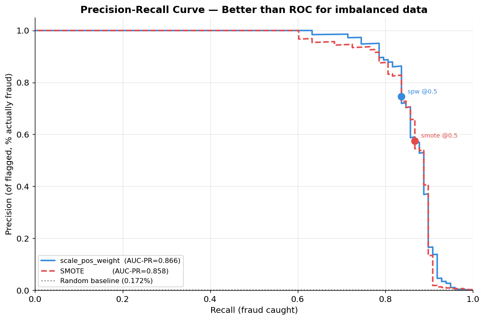
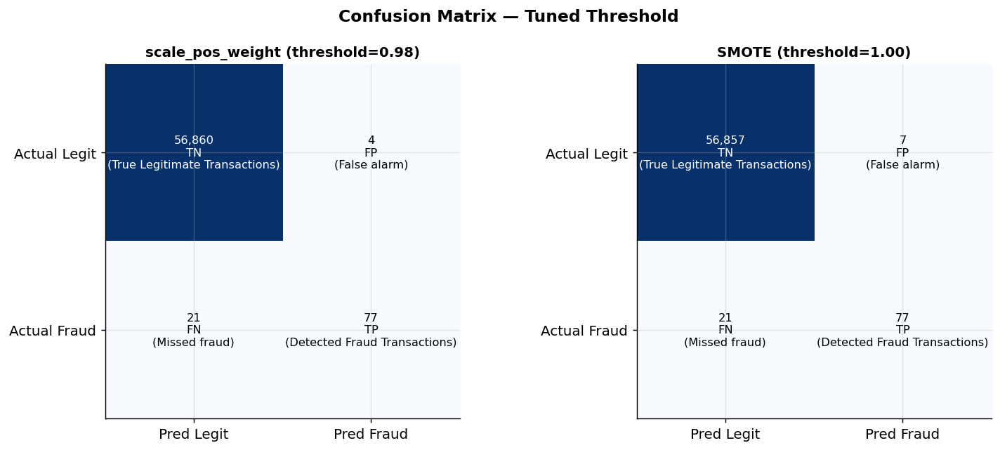

---

## Phase 5 — Modelling

**Model comparison:**

| Model               | AUC-ROC    | AUC-PR     | F1\*      | Notes                                                   |
| ------------------- | ---------- | ---------- | --------- | ------------------------------------------------------- |
| Logistic Regression | 0.9709     | 0.7297     | 0.672     | Floor to beat                                           |
| Random Forest       | 0.9829     | 0.8072     | 0.611     | Precision 0.957 but recall only 0.449                   |
| XGBoost (default)   | 0.9808     | 0.8615     | 0.840     | Strong out of the box                                   |
| **XGBoost (tuned)** | **0.9766** | **0.8804** | **0.860** | **Final model** — best AUC-PR and F1                    |

\*Precision/Recall/F1 for all four models were computed at one threshold (0.982, tuned for XGBoost), which penalises Logistic Regression and Random Forest — **AUC-PR is the fair comparison**. The tuned model was selected on AUC-PR; its AUC-ROC is slightly lower than Random Forest and default XGBoost.

**GridSearchCV parameters tuned:**

```python
param_grid = {
    'max_depth'        : [4, 6, 8],
    'learning_rate'    : [0.05, 0.1, 0.2],
    'n_estimators'     : [100, 200],
    'subsample'        : [0.8, 1.0],
    'colsample_bytree' : [0.8, 1.0],
}
# Scored on: average_precision (AUC-PR)
# CV: StratifiedKFold(n_splits=5)
# 72 candidates x 5 folds = 360 fits (10.6 min)
# Best CV AUC-PR: 0.8513
# Best params: max_depth=8, learning_rate=0.1, n_estimators=200,
#              subsample=0.8, colsample_bytree=0.8
```

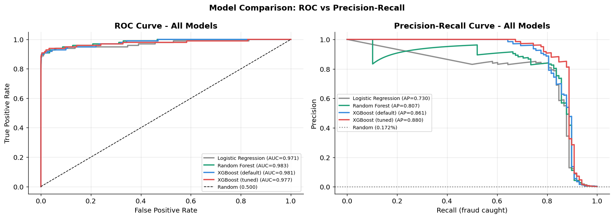

---

## Phase 6 — SHAP Explainability

**Why SHAP?** TreeExplainer gives exact Shapley values for XGBoost — mathematically rigorous attribution from game theory. Computed on all 98 test fraud cases plus 1,000 random legitimate transactions.

**6 charts produced:**

| Chart                         | Purpose                              |
| ----------------------------- | ------------------------------------ |
| Summary plot (beeswarm)       | Global feature importance            |
| Bar plot                      | Mean \|SHAP\| ranking                |
| Waterfall — fraud transaction | Why THIS transaction was flagged     |
| Waterfall — legit transaction | Why THIS transaction was cleared     |
| Dependence plots (top 3)      | How feature value affects fraud risk |
| Fraud vs legit comparison     | Feature importance split by class    |

**Top 5 SHAP features:**

| Feature | Mean \|SHAP\| | Direction                       |
| ------- | ------------- | ------------------------------- |
| V14     | 2.665         | Low values → fraud risk ↑       |
| V4      | 2.478         | High values → fraud risk ↑      |
| V10     | 1.132         | Low values → fraud risk ↑       |
| V12     | 1.123         | Low values → fraud risk ↑       |
| V3      | 0.749         | Low values → fraud risk ↑       |

**Example — highest-confidence fraud transaction (fraud probability 100%):** V14 = -13.69 (SHAP +4.50), V10 = -12.81 (+1.83), V4 = 8.93 (+1.63), V12 = -13.06 (+0.92), V3 = -13.27 (+0.84).

**Key insight:** V14 is #2 by correlation and #1 in SHAP. V17 has the strongest correlation but is not in the SHAP top 20. Engineered features rank low (`log_amount` #10, `txn_velocity_10m` #18; `is_night` and `txn_velocity_1h` outside the top 20). V1–V28 are anonymised, so they cannot be mapped to business meanings.

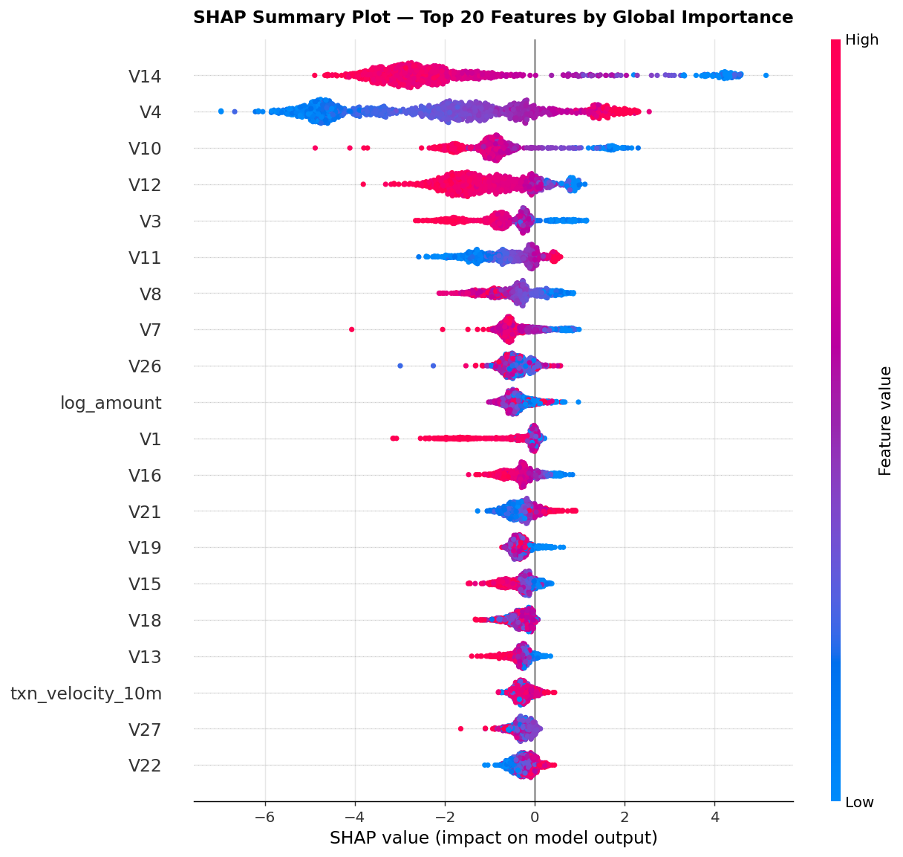
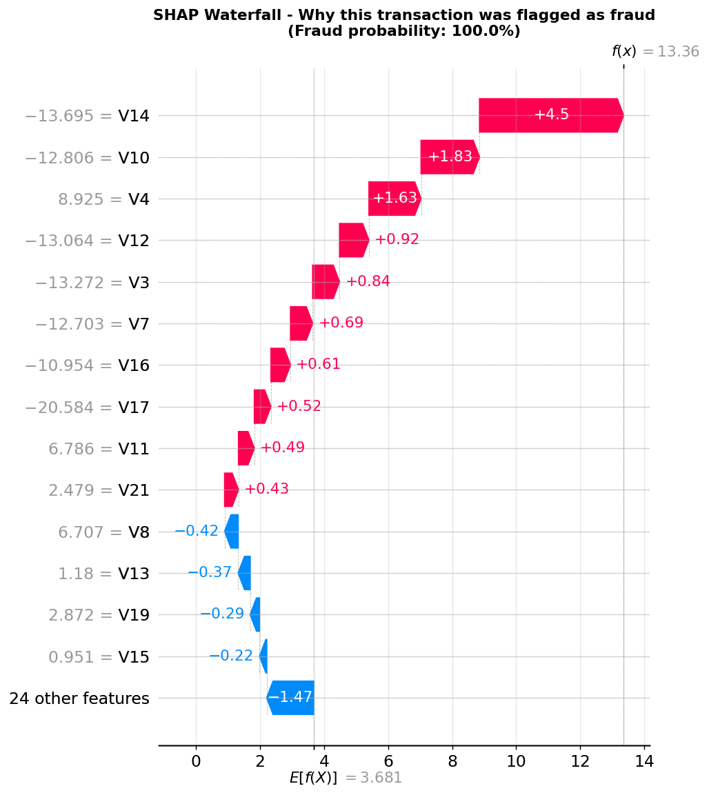

---

## Phase 7 — Business ROI & Cost Analysis

**Cost matrix (assumed, not from a real institution):**

| Decision                       | Cost     | Business impact              |
| ------------------------------ | -------- | ---------------------------- |
| False Negative (missed fraud)  | **$150** | Revenue loss                 |
| False Positive (blocked legit) | **$15**  | Customer friction + ops cost |
| True Positive (caught fraud)   | $0       | Fraud prevented              |
| True Negative (cleared legit)  | $0       | Happy customer               |

**Scenario comparison:**

| Scenario                   | Fraud Caught | FN Cost    | FP Cost  | Total Cost |
| -------------------------- | ------------ | ---------- | -------- | ---------- |
| No model                   | 0            | $14,700    | $0       | $14,700    |
| Default threshold 0.5      | 81           | $2,550     | $165     | $2,715     |
| **Optimal threshold 0.09** | **87**       | **$1,650** | **$300** | **$1,950** |

**Net saving vs no model: $12,750.** Tuning the threshold alone (0.5 → 0.09) saves **$765**.

**Reading the dollars:** $150 is an assumed all-in cost per missed fraud. The actual transaction amounts in the test set total $10,373.77 (about $105.86 per fraud case), so the "saving" is an output of the cost model, not literal fraud dollars. At the 0.09 threshold, $8,547.84 of actual fraud value is caught (82.4%) and $1,825.93 is missed.

**Sensitivity analysis:** across 25 cost combinations (FN $50–$300, FP $5–$30) the optimal threshold is 0.09 in 21 cases and 0.14 in the other 4 (when the FN:FP cost ratio is about 3.3 or lower).

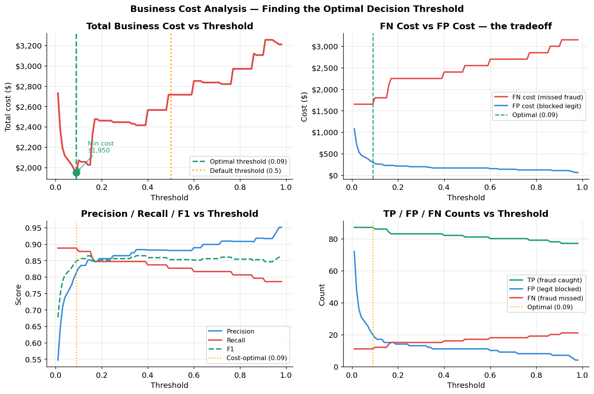
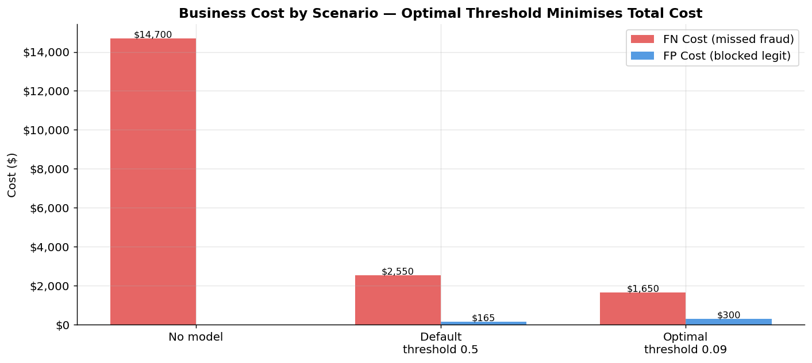

---

## Phase 8 — Tableau Dashboard

## Live Dashboard

🔗 **[View on Tableau Public](https://public.tableau.com/views/CreditCardFraudDetection-RiskAnalyticsDashboard/Dashboard1?:language=en-US&:sid=&:redirect=auth&:display_count=n&:origin=viz_share_link)**

**4 interactive views:**

| View                                | Chart Type            | Business Question                       |
| ----------------------------------- | --------------------- | --------------------------------------- |
| Risk Score Distribution             | Histogram (log scale) | How well separated is fraud from legit? |
| Fraud Rate by Hour                  | Dual-axis line + bar  | Which hours have highest fraud risk?    |
| Business Cost by Outcome            | Bar chart + KPIs      | What does each decision type cost?      |
| Fraud Investigation Priority Matrix | Highlight table       | Which risk tier to investigate first?   |

**KPI strip (always visible):**

- Total Business Cost: **$1,950**
- Fraud Cases Caught: **87**
- Fraud Cases Missed: **11** (red)
- Total Fraud Value at Risk: **$1,825.93** (actual amount of the 11 missed cases)

**Risk bands (from fraud probability):** Very Low 56,865 · Low 4 · Medium 3 · High 3 · **Very High 87**. The Very High band holds 79 fraud and 8 false alarms (90.8% precision); all 11 missed fraud cases fall in the Very Low band.

**Interactive features:**

- Click any Risk Band row → filters the charts to that tier
- Outcome color coding: TP=green, FP=amber, FN=red, TN=gray

---

## Limitations

- **Thresholds were chosen on the test set.** Both the F1-optimal (0.982) and cost-optimal (0.09) thresholds used test-set predictions, so operating-point metrics are optimistic. In production, choose the threshold on a separate validation split.
- **Small positive class.** The test set has 98 fraud cases from a single stratified split; no repeated or time-based split was run.
- **Assumed costs.** The $150 / $15 figures are assumptions; the sensitivity analysis shows how the threshold moves.
- **No card ID and anonymised features.** Velocity is traffic-level, not per card, and PCA components cannot be interpreted in business terms.
- **Two days of data** from one region; fraud patterns drift over time.

---

## Repository Structure

```
Credit-Card-Fraud-Detection-Transaction-Risk-Analytics/
│
├── Credit Card Fraud Detection.ipynb      (EDA → feature engineering → modelling → SHAP → cost analysis)
├── creditcardfraud.sql                    (MySQL queries and views)
├── Credit Card Fraud Detection - Risk Analytics Dashboard.twbx
│
├── fraud_model_xgb.pkl                    (trained XGBoost model)
├── scaler.pkl                             (StandardScaler)
├── phase4_config.json                     (scale_pos_weight, feature list, thresholds)
│
├── hourly_fraud_summary.csv               (MySQL export)
├── fraud_amount_buckets.csv               (MySQL export)
│
├── eda_*.png, imb_*.png, model_*.png,     (saved charts)
│   shap_*.png, roi_*.png
│
├── requirements.txt
└── README.md
```

Large files (raw `creditcard.csv`, `clean_transactions_full.csv`, `featured_transactions.csv`, `scored_transactions.csv`, `tableau_fraud_data.csv`) are not stored in the repo; the notebook regenerates them. `phase4_config.json` holds `best_threshold` 0.40 after a manual edit; the notebook itself writes 0.982.

---

## Setup & Installation

```bash
# Clone the repository
git clone https://github.com/sandeepsingh9871/Credit-Card-Fraud-Detection-Transaction-Risk-Analytics.git
cd Credit-Card-Fraud-Detection-Transaction-Risk-Analytics

# Install dependencies
pip install -r requirements.txt

# Download dataset
# Download creditcard.csv from: https://www.kaggle.com/datasets/mlg-ulb/creditcardfraud

# Phase 1: load creditcard.csv into MySQL, run creditcardfraud.sql,
#          then export clean_transactions with INTO OUTFILE (no header row)
#          Place clean_transactions_full.csv next to the notebook

# Phases 2-7: run Credit Card Fraud Detection.ipynb top to bottom
#             (the GridSearchCV cell takes about 10 minutes)
```

---

## Requirements

```
pandas
numpy
matplotlib
seaborn
scikit-learn
xgboost
imbalanced-learn
shap
joblib
```

## Results Summary

```
Dataset        : 284,807 transactions | 492 fraud cases | 0.17% fraud rate
Model          : XGBoost (scale_pos_weight=577.3 | GridSearchCV | 5-fold stratified CV)
AUC-ROC        : 0.977
AUC-PR         : 0.880
Threshold      : 0.09 (cost-optimised, selected on the test set)
Precision      : 0.813   (at threshold 0.09)
Recall         : 0.888   (at threshold 0.09)
F1             : 0.849   (at threshold 0.09)
Fraud caught   : 87 / 98 (88.8% recall) | 20 false alarms | 11 missed
Business cost  : $1,950 total | $12,750 saved vs no model (assumed $150 / $15 costs)
Top SHAP feats : V14, V4, V10, V12, V3
```

---

*Dataset: [Kaggle Credit Card Fraud Detection](https://www.kaggle.com/datasets/mlg-ulb/creditcardfraud)*

---

## 📬 Contact

**Sandeep Singh**

- 💼 [LinkedIn](https://www.linkedin.com/in/sandeep-singh-aaa1271b7/)
- 📧 [Email](mailto:sandeepsinghss9871@gmail.com)
- 💻 [GitHub](https://github.com/sandeepsingh9871)
- 🌐 [Portfolio](https://sandeep-data-analyst-portfolio.vercel.app/)
